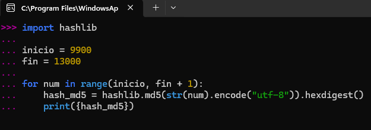
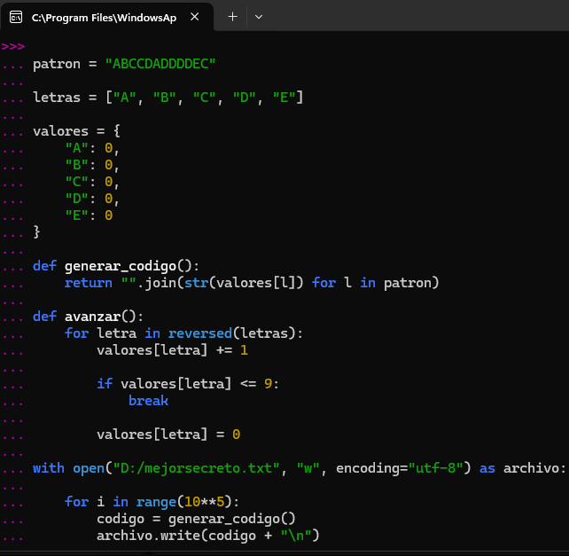
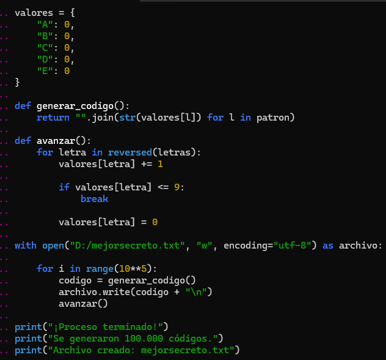
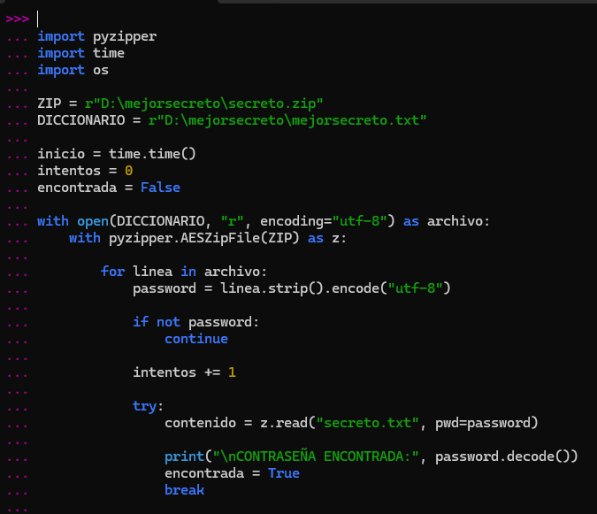
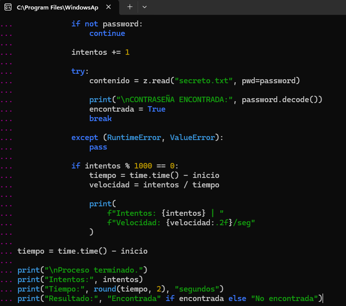

**Objetivo 11: Ejecución del Laboratorios**

**Laboratorio Apagar la IA:**

Comenzamos abriendo el laboratorio y su enunciado el cual lo leeremos para comprender que es lo que nos pide. Entramos a la pestaña del laboratorio a resolver y vemos que nos da 2 hash md5 que si lo apretamos nos envía a una pagina donde nos hace ver los códigos de numero dentro de ellas lo cual comprendemos que debemos descifrar de que valor numérico son esos hash md5. el primero **0e1422ea79781ee046484893ce0010c4** tiene el valor numérico 9912 y el segundo **0602940f23884f782058efac46f64b0f** tiene el valor numérico 9995, en el cual deducimos que debemos hacer una búsqueda del rango 9900 al 13000 para buscar ese numero de 16 dígitos dentro de algunos de esas paginas con dichos hash md5.

Primero abrimos el burpsuite y buscamos el endpoint de los códigos y los mandamos al intruder en el cual seleccionamos el hash md5 del **GET** y lo transformamos en variable con la función **Playloads** el cual seleccionamos en la opción de lista simple y la configuración seleccionamos el archivo de texto con los hashes de los números del rango 9900 al 13000, que lo convertimos usando el comando en phyton el cual nos genera la lista de los hashes a utilizar:

Con todo eso iniciamos el ataque y podemos ver que funciona, pero no podemos encontrar la pagina que tiene los 16 dígitos en su interior lo cual usamos otra de las herramientas del intruder en la parte de sentting nos vamos a la parte **de GREP-Extract** y apretamos añadir para que nos abra una pestaña el cual debemos configurar lo que deseamos buscar en la parte **de Extract from regex group** seleccionamos y tenemos que escribir el código que deseemos buscar en nuestro caso seria **(<**li**>\d{16}</**li**>)** lo que dice es que nos devolverá el valor encerrado que buscamos que contenga 16 dígitos y volvemos a comenzar el ataque y vemos que se nos agrega una nueva pestaña donde se encuentra el código de búsqueda que colocamos, cuando termine lo seleccionamos para que lo ordenemos y nos entregue el endpoint que contiene dicho valor el cual es **5524663362514956** y con ese valor tenemos que ir a un convertidor de hash md5 de cualquier pagina web para que nos convierta el valor en el resultado que necesitamos para completar el laboratorio el cual es **a8e0e8ff02dde0f62fdf4de5142d7de0.**

**Laboratorio El Mejor Secreto:**
Para resolver este laboratorio necesitaremos una concentración total el cual en el video tenemos que identificar la cantidad de veces que presiona la tecla viendo claramente si la presiono y con el sonido identificar si pulsa o no esa tecla correctamente, lo cual vemos que presiono 12 veces la tecla y con eso en mente ahora tenemos que observar la cantidad de veces que presiono la misma tecla para así descifrar un patrón que nos servirá para ahorrar tiempo de proceso ya que si hacemos fuerza bruta demorara mas tiempo en resolverse en si serian 12^10 casi 62 millones de líneas de código, pero con descifrar las pulsaciones obtendremos **ABCCDADDDDEC** cada letra seria un numero el cual nos daría 5^10 son como 100000 líneas de código es mucho menor al querer hacerlo con fuerza bruta.

Con esto ya resuelto podemos realizar el laboratorio en mi caso use la ayuda de la IA para que me cree un código el cual me devuelva las 5^10 combinaciones en un archivo de texto el cual es:

Con esto creamos una carpeta en el cual pondremos el archivo **secreto.zip** y el archivo

mejorsecreto.txt que contiene todas las líneas de comando que tendremos que probar.

ahora descargamos **pyzipper** que es una herramienta que nos ayudara a realizar de manera autónoma la fuerza bruta al archivo **secreto.zip,** con esto ya podemos pasar al código que nos ayudara a resolver este laboratorio:

esperamos que resuelva y vemos que nos encuentra la contraseña en el intento 54794 y la cual es: **547795999937** y con eso abrimos el archivo **secreto.zip** y nos entrega el hash del laboratorio.

**Laboratorio Votación:**
En este laboratorio podemos ver que la UCC le gana de votos a la UTN y nuestro deber es buscar una forma de hacer que la UTN lo supere de votos, en este caso vamos al burpsuite y vemos los 2 endpoint que tenemos antes y después de hacer el voto, podemos ver que en el enpoint **/src/ctl/votacion.ctl.php** lo mandamos al repeater para corroborar algunas cosa, al enviar el endpoint a la pagina nos hace ver una **Set-Cookie: voto=s8fvks7dk3ncq0**, en lo cual al seguir enviando la misma resquest nos suma los votos ya que en nuestra cookie no esta la set cookie marcándonos y nos es la mejor forma haciéndolo asi por eso después pasaremos el endpoint al intruder. Es raro de ver en las paginas web una set cookie y es información que no se tiene que ver.

En el otro endpoint **/src/ctl/votacion.ctl.php** después de realizar la votación podemos ver que a nuestra cookie se agrega el **Set-Cookie: voto=s8fvks7dk3ncq0** a nuestra cookie y con esto damos por determinado que al usar el primer endpoint podemos mandarlo al intruder el cual nos permitirá usar el primer endpoint para poder realizar los votos necesarios para que gane la UTN.

Solo debemos cambiar cualquier valor numérico del body para que se pueda hacer el ataque en este caso use la versión del **Firefox/$159$.0** el cual lo encerré en una variable y que recorra valores entre el 0 y el 3500 para poder hacer el ataque, el cual lo enviamos y podemos ver que se van aceptando los votos y al finalizar podemos recargar la pagina y nos dará el código de laboratorio resuelto.

**Laboratorio Votación Nueva Versión:**
En este laboratorio es el mismo que el anterior solo que en este al realizar de nuevo la votación nos dice que no podes votar desde la misma **IP** en si estamos bloqueados por **IP**, por lo que al tratar de resolverlo de la forma anterior no nos contaría los votos. 

En estos casos desde el **Repeater** tenemos que resolverlo escribiendo una cabecera en el body con el cual nos permitirá cambiar de **IP** la cual es: **X-Forwarded-For: 190.234.214.1** corroboramos pasando la petición y podemos ver que nos acepta el voto por el cual mandamos al **Intruder** el endpoint, el cual cambiaremos las variables de la **IP** para que nos cuente los votos en este caso lo haremos en dos partes: primero en **190.234.214.$1$** y después en **190.234.$214$.1** en un rango de hasta 250 para que sea bastante rápido.

Una vez realizado refrescamos la pagina de votos y podemos ver que nos entrega el hash md5 para resolver el laboratorio.

