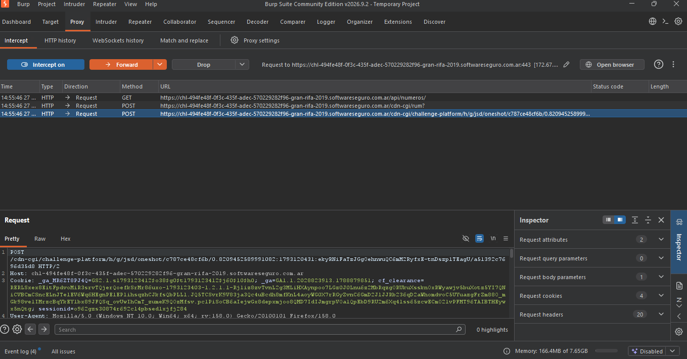

Objetivo 8: Man-in-the-Middle Local (Configuración y Certificado CA)

Debemos comenzar abriendo al burpsuite y activar el foxyproxy.

Buscamos en el burpsuite el encabezado **proxy** y en la parte de **interceps** lo encendemos y volvemos al navegador y resfrescamos el laboratorio que deseemos resolver(gran rifa19 en mi caso).

Volvemos al burpsuite y vemos que intercepto 3 endpoints:

Podemos ver que el endpoint **/api/numeros/** tiene un método **GET** y su función es:

solicitar o consultar los datos de las personas que compraron la rifa y quedaron cargadas en el sistema.

Podemos ver que el endpoint **/cdn-cgi/rum?** tiene un método **POST** y su función es:

el endpoint pertenece a cloudflare por el prefijo **cdn-cgi** y **RUM** es Real User Monitoring (Monitoreo de Usuario Real). Su función es enviar reportes de rendimiento de vuelta a Cloudflare de forma automática.

Podemos ver el endpoint **/cdn-cgi/challenge-platform/h/g/jsd/oneshot/…** tiene un método **POST** y su función es:

Pertenece a Cloudflare y forma parte de su sistema de mitigación de bots y telemetría de seguridad. Es el encargado de ejecutar el "desafío invisible" (el script de JavaScript que corre en segundo plano en tu navegador) para comprobar si eres un usuario real o un script automatizado.

