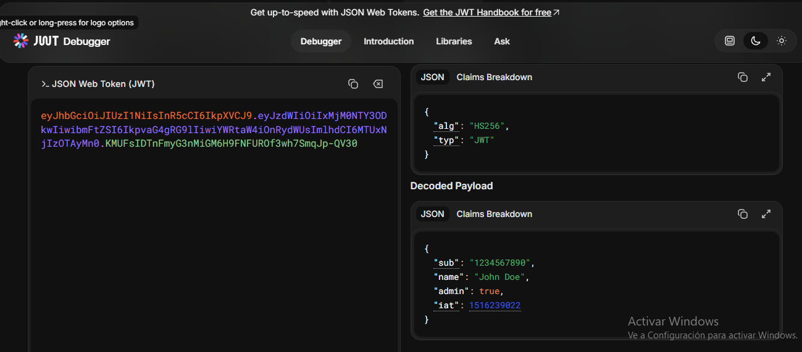

**En la imagen podemos ver de prueba un JWT de la pagina jwt.io con el cual trabajaremos:**

**1. Algoritmo de firma (Header):**

* Algoritmo utilizado: HS256 (HMAC con SHA-256).
* Estructura: El encabezado decodificado muestra {"alg": "HS256", "typ": "JWT"}, lo que indica que es un token firmado simétricamente utilizando una clave secreta compartida.

**2. Datos y roles en texto plano (Payload):**

Al decodificar el cuerpo del token (que está codificado en Base64Url, no cifrado), se exponen los siguientes datos en texto plano:

* **Rol / Privilegio (admin):** "admin": true. Expone explícitamente que el usuario tiene privilegios de administrador en la aplicación.
* **Identificador del usuario (sub):** "sub": "1234567890". Representa el ID único del sujeto/usuario.
* **Nombre (name): "name":** "John Doe". Información personal identificable (PII).
* **Fecha de emisión (iat):** "iat": 1516239022. Marca de tiempo Unix (Issued At) que indica cuándo se creó el token (18 de enero de 2018).

